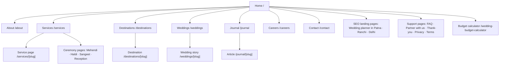
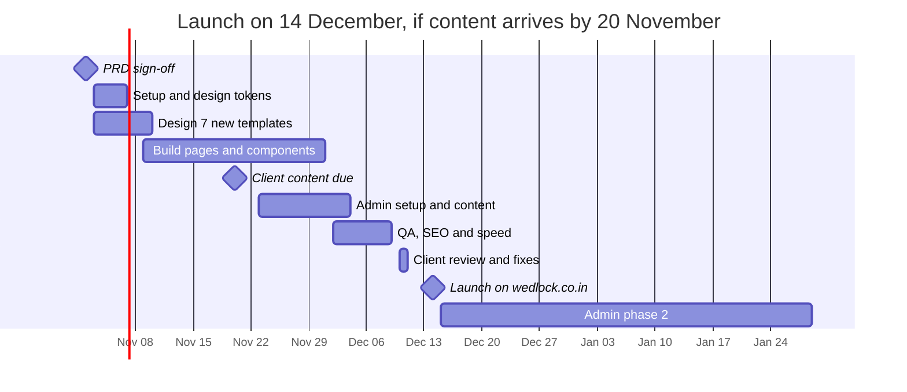

# Wedlock Website — Product Requirements Document

> Live, editable version: [Wedlock Website — PRD](https://claude.ai/artifact/9TfHRr6CPEYXo91yfRAyNZ) · Design: [Wedlock Website Mockup](https://claude.ai/artifact/J5c2qCQ7Vwh7ApiKkydnFu)

## 1. Overview

We will rebuild wedlock.co.in as a 10-page website that makes Wedlock look like an established, premium wedding company and turns visitors into WhatsApp and form enquiries. The approved design is "Option E" on the [design canvas](https://claude.ai/artifact/J5c2qCQ7Vwh7ApiKkydnFu).

**Why now.** The current site (wedlock.co.in, built 2024) is a template with placeholder text, no testimonials and a broken form number. The earlier proposal (wedlock-ten.vercel.app) was rejected: the client said it "looks like a normal AI-generated website" — six fonts including four scripts, five accent colours, repeated card grids and "0+" counters.

**Goals**

1. Present Wedlock as a premium, experienced company, built on its real work and the Eventoss lineage.
2. Generate qualified enquiries — mainly through WhatsApp, with forms as the fallback.
3. Rank for wedding-planner searches in Patna, Ranchi, Delhi and the main destination cities.
4. Let the Wedlock team update content and images, and manage leads, vendors and events, from one admin panel without a developer.

**Success metrics (first 90 days after launch)**

| Metric | Target | How measured |
| --- | --- | --- |
| Enquiries (WhatsApp clicks + form submissions) | [Baseline from client] → 2× | GA4 events |
| Enquiry conversion rate | ≥ 3% of sessions | GA4 |
| Mobile Lighthouse performance | ≥ 90 | Lighthouse CI |
| Core Web Vitals | All "Good" (LCP < 2.5 s, INP < 200 ms, CLS < 0.1) | Search Console |
| Pages indexed | All 10 + every wedding, destination and article page | Search Console |
| Client acceptance | "Premium, not AI-generated" sign-off | Review meeting |

## 2. Users and personas

The primary user is a couple, or their parents, comparing planners on a phone; every page must make the next step — WhatsApp or call — one tap away.

| Persona | Who | Needs from the site | Top task | Key pages |
| --- | --- | --- | --- | --- |
| The couple | 25–34, Bihar/Jharkhand/Delhi, researching on mobile and Instagram | Proof of real weddings, style, rough cost | See work, then start a WhatsApp chat | Home, Weddings, Wedding story, Services |
| The parents | 50–65, often the decision-maker and payer | Trust, experience, hospitality for elders and guests | Call or WhatsApp the team | Home, About, Contact |
| NRI / destination family | Abroad or metro, planning in another city | Destination options, logistics, one point of contact | Compare destinations, ask for options | Destinations, Destination weddings |
| Vendor / venue | Decorators, caterers, artists, hotels | How to partner | Send a partner request | Contact |
| Job seeker | Planners, designers, production crew | Open roles, culture | Apply | Careers |

About 80% of traffic is expected on mobile [to confirm with client analytics]; Hindi-speaking parents may use the site, so copy stays short and plain, with Hindi used only as accents.

## 3. Scope

Version 1 is a fast marketing website with a content editor; bookings, payments and client logins come later.

**In scope (v1)**

- 10 page templates from the approved design, fully responsive (desktop, tablet, mobile)
- Repeatable detail pages: wedding stories, destinations, journal articles, service details
- Launch extras (section 5): 3 city landing pages (Patna, Ranchi, Delhi), 4 ceremony pages (Mehendi, Haldi, Sangeet, Reception), FAQ, Partner with us, Thank-you, Privacy Policy, Terms & Conditions
- Shared header, footer (with the "Made with ❤️ by Kynyx" credit) and floating WhatsApp button
- WhatsApp deep links with a prefilled first message for every page, service, destination and filter
- Enquiry, newsletter, partner and job forms, delivered to email and the admin lead inbox
- **Admin panel (section 14)** at `/admin`: journal, couple stories, media library and galleries with "replace everywhere", site content, packages and add-ons, lead management — in two phases, with vendor and event management in phase 2
- SEO basics: metadata, schema markup, sitemap, redirects from the old wedlock.co.in URLs
- Analytics (GA4 + Meta Pixel) and conversion events

**Out of scope (v1) — planned for v2 in section 13**

- Online booking, payments or quotes
- Client portal (the "shared planning portal" mentioned in copy is a sales claim, not a v1 feature)
- Hindi version of the whole site
- Blog comments, user accounts
- Birthdays, anniversaries and other non-wedding occasions as separate sections

**Assumptions**

- Wedlock supplies unwatermarked high-resolution photos before content entry.
- The domain wedlock.co.in stays; DNS access is available at launch.
- WhatsApp Business number is +91 70615 28402.

## 4. Sitemap and navigation

Home links to seven top-level pages; Services, Destinations, Weddings and Journal each add a repeatable detail page managed in the admin; thirteen launch extras (city, ceremony, FAQ, partner, thank-you and legal pages, plus the wedding budget calculator) and a 404 page complete v1.

On every page: header · footer with Kynyx credit · floating WhatsApp button.

The header carries all top-level pages except Careers and the Budget calculator, which sit in the top bar and footer; the calculator is also promoted on Home (a band between Packages and How it works) and under the budget field on Contact. URLs are lowercase and hyphenated, and every old wedlock.co.in URL redirects to its new page (section 10).

## 5. Page requirements

Each page must match its board on the design canvas section for section; the table lists what each page contains and what it must do.

| Page | URL | Sections (top to bottom) | Must do | WhatsApp first message |
| --- | --- | --- | --- | --- |
| Home | `/` | Hero with photo, "Est. 2014 Patna" seal and quote · cities strip · 6 reasons · stats band · 8 services · 6 destinations · featured weddings · 3 packages · 4-step process · testimonials + film · 3 journal posts · enquiry CTA | Load hero image first (LCP); all cards link to their pages | "I'm planning my wedding and would love a free consultation…" |
| About | `/about` | Hero + photo collage · story · timeline 2014–today · 4 values · leadership (3) · 3 offices · Eventoss lineage · two CTAs | Leadership and offices editable in the admin | "…would like to know how you can help plan our wedding." |
| Services | `/services` | Hero + in-page nav · 3 packages · 12-row comparison table · 8 specialist teams · ceremonies + traditions · add-ons · CTA | Each service card has "Ask on WhatsApp" with the service name; table scrolls sideways on mobile | Page: packages message; card: "…your [service] service…" |
| Service detail | `/services/[slug]` (v1: destination-weddings) | Hero + key facts · what's included (12) · popular destinations · sample 3-day itinerary · process · case study + quote · FAQ · CTA | Template reusable for every service | "…interested in a destination wedding…" |
| Destinations | `/destinations` | Hero · featured Rajasthan card · filter + grid of 8 · "every destination comes with" strip · CTA | Filters (All, Rajasthan, Coast & backwaters, International) work without reload; URL keeps the filter (`?type=`) | Changes with the active filter |
| Destination detail | `/destinations/[slug]` | Hero, best season, guest range, venues, gallery, FAQ, CTA | New template (not on canvas) — follows Service detail layout | "…a wedding in [destination]…" |
| Weddings | `/weddings` | Hero · filters + photo grid · wedding films · reviews · CTA | Filters (All, Weddings, Haldi & Mehendi, Sangeet & Reception, Décor); "Load more" pages through admin entries | Changes with the active filter |
| Wedding story | `/weddings/[slug]` | Hero · facts bar · brief/approach/result · events · gallery · couple quote · credits · more stories · CTA | Gallery opens a full-screen lightbox | "…saw [couple]'s celebration…" |
| Journal | `/journal` | Hero + categories + search · featured article · grid · pagination · PDF lead magnet | Category filter and search work; PDF form captures email before download | "…questions about planning my wedding." |
| Article | `/journal/[slug]` | Title, date, read time, hero image, rich text, related posts, CTA | New template (not on canvas) | Same as Journal |
| Careers | `/careers` | Hero · perks · roles list with team/city filters · hiring steps · internship CTA | Roles come from the admin; "Apply" opens a form with CV upload | "…I'd like to join your team…" |
| Contact | `/contact` | Hero + 4 contact cards · full enquiry form · offices + map · FAQ · vendor CTA | Form validates, confirms on screen, sends lead (section 9) | "…book a free consultation… Date · City · Guests" |
| 404 | any unknown URL | Short message, search, links to Home, Weddings, Contact | Returns HTTP 404 | Home message |

**Launch extras (v1).** Twelve more pages from five new templates (city, FAQ, partner, thank-you, legal) plus the existing Service detail template; designs to be added to the canvas before build.

| Page | URL | Sections (top to bottom) | Must do | WhatsApp first message |
| --- | --- | --- | --- | --- |
| City landing × 3 | `/wedding-planner-patna`, `/wedding-planner-ranchi`, `/wedding-planner-delhi` | Hero "Wedding planners in [city]" · why Wedlock in [city] · local venues we know · weddings in [city] (from the admin) · services · office address + map · city FAQ · CTA | One template, content per city in the admin; `LocalBusiness` schema with that office; unique copy per city (no copy-paste between cities) | "…planning my wedding in [city]…" |
| Ceremony × 4 | `/services/mehendi-planning`, `/haldi-planning`, `/sangeet-planning`, `/reception-planning` | Service detail template: hero · what we plan for this ceremony · décor ideas gallery · sample timeline · related weddings · FAQ · CTA | Reuses Service detail; linked from the Services page ceremonies list | "…help planning our [ceremony]…" |
| FAQ | `/faq` | Hero · grouped questions (Planning, Pricing & payments, Destinations, On the day) · CTA | Questions from the admin; `FAQPage` schema; Contact keeps its short FAQ and links here | "…I have a question about planning my wedding." |
| Partner with us | `/partner` | Hero · why partner with Wedlock (650+ celebrations, 40+ cities) · categories we work with · how it works (3 steps) · partner form | Partner form (section 9); replaces the Contact page vendor CTA link | "…I'm a [vendor/venue] and would like to partner with Wedlock." |
| Thank-you | `/thank-you` | Confirmation "A planner will call you within 24 hours" · WhatsApp now button · 3 wedding stories · Instagram link | Every enquiry form redirects here; fires `generate_lead` / `Lead` here only; `noindex` | "…I just sent an enquiry on your website." |
| Privacy Policy | `/privacy` | Plain legal text page, last-updated date | Covers forms, cookies, Meta Pixel, data retention; text from client's lawyer | — |
| Terms & Conditions | `/terms` | Plain legal text page, last-updated date | Booking amount, payments, postponement and cancellation rules | — |
| Wedding budget calculator | `/wedding-budget-calculator` | Hero "What will our wedding really cost?" · six steps (city, guests, functions, venue type, décor level, add-ons) · live estimate panel with range and breakdown by category · how we estimate (3 cards) · related links | Runs in the browser, no page reload; rates come from the admin (Packages → Calculator rates); shows a ±15% range, never one number; the planning fee is not included and is said so; "Get the full breakdown on WhatsApp" sends every choice and the estimate, logged as a `calculator_lead` event; nothing is stored unless the visitor sends it | "…I used your budget calculator. Patna, 400 guests, … Estimate ₹X–₹Y. Please send the full breakdown." |

**Services and add-ons catalogue.** The Services page lists 8 specialist services and the add-ons below; Return gifts is added at the client's request, and items marked "Proposed" need the client's yes before launch. All are managed under Packages & add-ons in the admin panel.

| Item | Type | What's included | Status |
| --- | --- | --- | --- |
| Photography & films | Service | Wedding photography and films — Wedlock's photos already carry a "Wedlock Wedding Photography" mark | Proposed — confirm this is an in-house service |
| Food & beverage curation | Service | Menu design, tastings, regional caterers, live counters, bar | Proposed |
| Return gifts | Add-on | Curated return gifts for guests: sourcing, personalised packaging and tags, distribution at the venue | Requested |
| Trousseau & shagun packing | Add-on | Decorated trays and baskets for shagun, trousseau and family exchanges | Proposed |
| Welcome hampers & room drops | Add-on | Personalised hampers and daily itinerary notes in guest rooms | Proposed |
| Live streaming | Add-on | Multi-camera live stream of key ceremonies for family who can't travel | Proposed |
| Pandit & ritual arrangements | Add-on | Pandit booking, puja samagri, muhurat coordination | Proposed |
| Baraat & grand entries | Add-on | Vintage car, horse, dhol, flower shower, couple entry concepts | Proposed |
| Special effects | Add-on | Cold pyro, confetti, fireworks where permitted | Proposed |
| Kids' zone & elder care | Add-on | Supervised kids' area; seating, transport and help desk for elders | Proposed |
| Valet & security | Add-on | Valet parking, guest list at the gate, venue security | Proposed |
| Same-day highlight film | Add-on | A short film edited and played at the reception | Proposed |
| Wedding website & RSVP app, Honeymoon planning, Sustainable wedding, Choreography classes, Pre-wedding shoot, Wedding insurance | Add-ons | As shown on the current design | In design |

**Mobile.** Every page reflows to one column at ≤ 640 px; the header collapses to a menu button; the mobile homepage board shows the reference layout, including the Call / WhatsApp bar.

**Acceptance for every page:** matches the canvas at 1440 px and 390 px, passes the checks in section 10, and every link and WhatsApp button opens the right target.

## 6. Global components

Header, footer and the WhatsApp button are built once and shared by every page, so a change in one place updates the whole site.

**Header**

- Top bar (dark): "Wedding planners since 2014 · Patna · Ranchi · New Delhi · Destinations across India & abroad", phone link, "WhatsApp us" (prefilled with the current section's message), Careers.
- Main bar: WEDLOCK wordmark + rings icon (links Home), 7 nav links in spaced capitals with a gold underline on the active page, "Book a consultation" button.
- Mobile: wordmark + menu button opening a full-screen menu; sticky on scroll.

**Footer**

- Newsletter strip, brand blurb ("Striking the perfect harmony between comfort and grandeur…"), Company / Services / Destinations / Head office columns.
- Bottom row: © 2026 Wedlock Wedding Planner · social links · Privacy Policy, Terms & Conditions · **"Made with ❤️ by Kynyx"** right-aligned, linking to https://kynyx.com in a new tab.
- The credit line is the last line on the page — no empty space below it.

**Floating WhatsApp button**

- Round 60 px dark button with a gold ring, WhatsApp glyph and green "online" dot, fixed 24 px from the bottom-right on every page.
- Opens `https://wa.me/917061528402?text=<message>` in a new tab; the message is URL-encoded and depends on the page, the service card, or the active filter (section 5).
- Has an accessible label ("Chat with Wedlock on WhatsApp") and never covers the footer credit at 1280 px and wider.
- Fires the analytics event `whatsapp_click` with the page and message key.

**Mobile action bar** — on phones a bottom bar with Call and WhatsApp replaces the floating button.

**Forms** — one shared form component (labels above fields, inline errors, success state); fields per form are listed in section 9.

## 7. Design system

The look follows the world's top luxury planners: one editorial serif, one quiet sans, near-monochrome colour with a single gold accent, square corners and real photography — no script fonts anywhere.

**Typography**

| Role | Font | Weight | Size desktop / mobile |
| --- | --- | --- | --- |
| H1 | Cormorant Garamond | Light 300, italic for one phrase | 100 / 46 px |
| H2 | Cormorant Garamond | Light 300 | 58 / 32 px |
| H3, card titles, numbers | Cormorant Garamond | Regular 400 | 24–36 px |
| Body | Manrope | Regular 400 | 17 / 16 px, line height 1.6 |
| Nav, buttons, labels | Manrope | SemiBold 600, uppercase, 0.14–0.22em tracking | 12–13 px |
| Hindi accents | Tiro Devanagari Hindi | Regular | 20 px |

All fonts load from Google Fonts with `font-display: swap`, self-hosted in production.

**Colour tokens**

| Token | Hex | Use |
| --- | --- | --- |
| `ivory` | #F6F4EE | Page background |
| `stone` | #ECEAE2 | Cards, alternate sections |
| `sage` | #DDE1D6 | Highlight sections |
| `ink` | #23271F | Text, dark bands, primary buttons |
| `moss` | #56604A | Highlight package, secondary buttons |
| `fern` | #4E5548 | Secondary text |
| `antique-gold` | #7E6233 | Small labels (passes 4.5:1 contrast) |
| `champagne` | #B8975F | Hairlines, seals, active nav line — decoration only |
| `line` | #DAD7CC | Dividers |

**Shape and spacing** — radius 2 px for buttons, fields and tags; 4–8 px cards and images; 12–16 px large panels. Max content width 1280 px, 32 px side gutters (16 px on mobile), 112 px between sections. No gradients; only floating cards get a soft shadow.

**Imagery** — only Wedlock's own photographs for weddings; captions name the couple and date when known. Stock images only for destinations and journal covers, with licences checked. No AI-generated people.

**Brand voice** — calm, experienced, family-first. Specific facts instead of superlatives; never "best" or "#1".

## 8. Content and assets

Most copy and all wedding photos come from Wedlock's own sites; seven facts still need the client's confirmation before launch.

**Facts in use**

| Fact | Value | Source | Status |
| --- | --- | --- | --- |
| Phone / WhatsApp | +91 70615 28402 (also 28401, 28404) | wedlock.co.in, proposal | Confirmed |
| Email | info@wedlock.co.in | wedlock.co.in | Confirmed |
| Head office | 208-A, Kaushalya Estate, Dak Bunglow Road, Patna | Proposal | Confirm |
| Offices | Patna (HQ), Ranchi, New Delhi | Both sites | Confirmed |
| Leadership | Syed Aabish Hassan (CEO & Founder), Rahul Ranjan (Executive Director & Co-founder), Aliwaris Khan (Director — Events & Entertainment) | eventoss.in, client | Confirmed |
| Founded | 2014, Patna | Proposal | **Confirm** — old site says "five years", brief said 15 |
| Scale | 650+ celebrations, 40+ cities, 14 countries | Proposal | **Confirm** |
| Featured weddings | Ankita & Anunay (reception 20 May 2023); Srestha & Vishal (Feb 2023) | Photos on the client's sites | **Confirm consent** |
| Testimonial | Aisha & Arjun Malhotra, Udaipur, "We never worried once" | Proposal | **Confirm real** — proposal reused Patna photos for it |
| Social | Instagram @wedlockweddings, Facebook, YouTube, X | wedlock.co.in | Confirmed |

**Photo inventory** (saved in the project under `assets/`)

- `client-photos/` — 20 Wedlock wedding photos (brides, couples, haldi, mehendi, sangeet, mandaps, stages, walkways). Several carry a "Wedlock Wedding Photography" watermark; unwatermarked originals are needed.
- `team/` — 3 leadership portraits from eventoss.in (380 × 573 px; higher resolution needed for retina).
- `stock-from-proposal/` — 6 destination and 7 journal images; licence to be verified or replaced.
- Missing: Udaipur and Goa destination photos, office photos, wedding film thumbnails.

**Still to write or supply**

- [ ] Package prices (3) and what each includes, final
- [ ] 4–6 real testimonials with names and permission
- [ ] Venue and city for each featured wedding
- [ ] Full text for 7 journal articles (titles exist from the proposal)
- [ ] Open roles and perks for Careers
- [ ] Privacy Policy and Terms & Conditions
- [ ] Brief / approach / result copy for each wedding story
- [ ] Unique copy, venues and FAQs for the 3 city pages (Patna, Ranchi, Delhi)
- [ ] Copy and photos for the 4 ceremony pages
- [ ] 15–20 FAQ answers for the FAQ page

## 9. Functional requirements

Every enquiry must reach the Wedlock team within one minute, by email and in the admin lead inbox, and the visitor must see a clear confirmation.

**Forms**

| Form | Where | Fields (* required) | Goes to |
| --- | --- | --- | --- |
| Wedding enquiry (full) | Contact | Name*, partner's name, phone (WhatsApp)*, email*, wedding date, city/destination, guests, budget band, service, events (checkboxes), message, how did you hear, consent* | Email to info@wedlock.co.in + admin lead inbox |
| Quick enquiry | Home CTA, Wedding story | Name*, phone*, email, what are you celebrating | Same as above |
| Newsletter | Footer | Email* | Email list [tool to choose] |
| Destination blueprint PDF | Journal | Email* | Email list, then PDF download |
| Vendor / venue partner | Contact | Business name*, category*, city*, phone*, portfolio link | partners@ [to confirm] |
| Job application | Careers | Name*, email*, phone*, role*, city, CV (PDF ≤ 5 MB)*, portfolio link | careers@ [to confirm] |

**Lead handling**

1. Validate in the browser (required fields, Indian mobile format +91 and 10 digits, email format) and again on the server.
2. Block spam with a honeypot field and Cloudflare Turnstile; no visible captcha.
3. Save the lead with page URL, UTM source and timestamp.
4. Email the team and send the visitor an auto-reply: "Thank you — a planner will call you within 24 hours."
5. Redirect to the /thank-you page, which confirms the enquiry and offers a "Chat on WhatsApp now" button.
6. Fire `generate_lead` (GA4) and `Lead` (Meta Pixel) on the thank-you page only, so ads count each lead once.

**WhatsApp deep links** — every WhatsApp button builds `https://wa.me/917061528402?text=` + the URL-encoded message for its page, service, destination or filter. Messages live in the admin so the team can edit them.

**Filters** — Destinations and Weddings filter on the client with no reload, update the URL query (`?type=`), and update the WhatsApp message to match.

**Content collections (managed in the admin panel, section 14)**

| Collection | Fields |
| --- | --- |
| Weddings | Couple, slug, date, city, venue, guests, event type, cover, gallery, brief/approach/result, events, quote, credits, featured flag |
| Destinations | Name, region, type, description, best season, guest range, images, WhatsApp message |
| Services | Title, summary, tags, image, detail page content, WhatsApp message |
| Journal | Title, category, date, read time, cover, body, author |
| Team | Name, role, note, portrait, order |
| Testimonials | Quote, names, wedding, permission flag |
| Jobs | Title, team, city, type, description, open/closed |
| Site settings | Phone, email, offices, social links, stats, packages and prices |

Publishing in the admin updates the live site within 60 seconds.

## 10. Non-functional requirements

The site must load fast on a mid-range Android phone over 4G, because that is how most families will first see it.

| Area | Requirement | How verified |
| --- | --- | --- |
| Performance | Lighthouse mobile ≥ 90; LCP < 2.5 s on "Slow 4G" and < 4 s on "Fast 3G"; INP < 200 ms, CLS < 0.1 | Lighthouse CI on every deploy, run with network throttling |
| Page weight | Before scrolling, a phone downloads ≤ 300 KB: HTML + CSS ≤ 40 KB, JavaScript ≤ 100 KB gzipped, two fonts ≤ 60 KB, hero image ≤ 90 KB. The whole homepage stays ≤ 1 MB on a phone | Bundle and page-weight check in CI |
| Images | Compressed when they are uploaded (section 11): AVIF with WebP fallback at 480, 960, 1600 and 2400 px; the browser picks the smallest size that fits; a blurred 20 px preview shows while the photo loads; hero preloaded, everything else lazy-loaded | Build check + spot check in admin |
| Video | Background loops ≤ 10 s, silent, 720p, ≤ 2.5 MB (MP4 H.264 + WebM) with a poster image; on data-saver or 2G/3G connections only the poster shows; full wedding films play from YouTube behind a "click to play" image, so no player loads until tapped | Manual test on a throttled phone |
| Fonts | Cormorant Garamond and Manrope self-hosted, subset to Latin, `font-display: swap`; Tiro Devanagari Hindi loads only on pages that use it | Build check |
| SEO | Unique title and description per page; Open Graph images; `LocalBusiness`, `Organization`, `Article`, `FAQPage` and `BreadcrumbList` schema; XML sitemap; robots.txt; canonical URLs | Search Console, Rich Results test |
| Redirects | 301s from every old wedlock.co.in URL (`/about/`, `/services/`, `/portfolios/`, `/contact/`, `/contact-us/`) to the new pages | Crawl before and after launch |
| Local SEO | Google Business Profile linked; consistent name, address, phone on every page | Manual check |
| Accessibility | WCAG 2.1 AA: 4.5:1 text contrast, keyboard navigation, visible focus, alt text on every photo, labels on every field | axe scan + keyboard test |
| Security | HTTPS only, security headers (CSP, HSTS), form rate limiting, no secrets in the client, admin behind login with 2FA | Header scan |
| Privacy | Cookie consent before Meta Pixel; consent checkbox on forms; Privacy Policy page | Manual check |
| Analytics | GA4 + Meta Pixel; events `whatsapp_click`, `call_click`, `generate_lead`, `filter_use`, `pdf_download` | GA4 DebugView |
| Browsers | Last 2 versions of Chrome, Safari, Edge, Firefox; iOS Safari 16+; Android Chrome | BrowserStack |
| Devices | 360, 390, 768, 1280, 1440 and 1920 px widths | Visual review |
| Uptime | 99.9% on the hosting plan; uptime monitor with alerts | Monitor |

## 11. Tech stack and architecture

One Next.js app on Vercel serves both the public site and a simple, custom-built admin panel at `/admin` (section 14). There is no CMS framework: the admin is a set of plain screens (sidebar, tables, forms), similar in spirit to the elyrashree.com admin, sitting on Supabase for login, data and files. Everything is chosen to run on free tiers at launch and to keep Vercel doing as little work as possible.

| Layer | Choice | Why |
| --- | --- | --- |
| Framework | Next.js (App Router) + TypeScript | Public pages are pre-built (static), so they cost Vercel almost nothing to serve |
| Styling | Tailwind CSS with the section 7 tokens | Small CSS; tokens match the design |
| Admin panel | Custom screens inside the same app at `/admin`; Markdown editor (textarea + toolbar, rendered with `marked`, cleaned with DOMPurify) | Simple to use and maintain; no CMS licence, no heavy admin bundle on the public site |
| Database + login | Supabase (Postgres + Auth), Mumbai region | Email + password login with authenticator-app codes; row-level security enforces roles; data stays in India |
| Media storage | Cloudflare R2, served from `media.wedlock.co.in` through Cloudflare's CDN | Free tier includes 10 GB and no download (egress) fees, so photos never use Vercel bandwidth |
| Image compression | In the admin, in the browser, at upload: each photo is resized and saved as AVIF + WebP at 480 / 960 / 1600 / 2400 px, plus a 20 px blurred preview; the original is kept in a private folder | No server time and no Vercel image-optimisation quota used; `next/image` runs with a custom loader that points at these files |
| Video compression | Short loops compressed in the browser with ffmpeg.wasm (≤ 10 s, 720p, MP4 + WebM, poster frame); full films go to YouTube | Small files for 3G/4G; long films never load until tapped |
| Email | Resend from `info@wedlock.co.in` | Lead alerts, auto-replies, follow-up reminders, and emails to couples and vendors from the admin; the free plan covers about 100 emails a day, enough for launch |
| WhatsApp | Click-to-chat links (`wa.me`) with the message pre-filled from a template; each send is logged | Free and works today. Bulk or automatic messages need the WhatsApp Business (Cloud) API, phase 2 |
| Hosting | Vercel, functions in Mumbai (bom1) | Fast in India; preview link for every change |
| Scheduled jobs | Supabase `pg_cron` (hourly follow-up reminders, nightly cleanup) | Does not depend on Vercel cron limits |
| Spam protection | Cloudflare Turnstile + honeypot | Invisible to users |
| Analytics | GA4 + Meta Pixel via Google Tag Manager, after consent, loaded after the page is interactive | Ads measurement without slowing first load |
| Backups & monitoring | Nightly database export to private storage (GitHub Action), 30 days kept; uptime monitor | The Supabase free plan has no point-in-time restore |

**Hosting plan.** For now the site runs on Vercel's free Hobby plan, to build and show the client. Before it goes live on wedlock.co.in it should move to Vercel Pro (about $20 a month per team member): Vercel's terms allow Hobby for [non-commercial, personal use only](https://vercel.com/docs/plans/hobby), and a Hobby limit that is exceeded stays blocked until 30 days pass ([Vercel limits](https://vercel.com/docs/limits)). The stack above keeps usage low, so the move is a billing change, not a rebuild.

**Free tiers to watch** — Supabase free projects pause after a week without activity (daily admin use prevents this) and have no point-in-time restore; Resend's free plan has a daily cap. Upgrade Supabase to Pro (about $25 a month) once real client data is stored. Check current limits before launch; they change often.

**How it fits together** — visitors load pre-built pages from Vercel's edge; when the team publishes in the admin, only the changed pages rebuild (on-demand revalidation), live within about a minute. Photos and videos come from R2 through Cloudflare, already compressed. Forms post to a server action that checks Turnstile, saves the lead in Supabase, emails the team through Resend and redirects to `/thank-you`. WhatsApp buttons open `wa.me` with the page's message and log the click. Every image is stored once and referenced by ID, which powers "replace everywhere".

**Code and environments** — GitHub repository; `main` deploys to production, every pull request gets a preview URL; secrets (Supabase service key, R2 keys, Resend key, Turnstile key) live in Vercel environment variables only and are never sent to the browser.

## 12. Delivery plan and open questions

The site can launch on Dec 14, 2026 if the client's content and photos arrive by Nov 20, 2026; each week of delay moves launch by about a week. Admin phase 2 (full lead pipeline, vendor and event management) follows by 29 January 2027.

Build runs in parallel with content collection; the client reviews on a Vercel preview link from the first week of December.

**Open questions for the client**

- [ ] Founding year: 2014 (proposal), "five years" (old site) or 15 years?
- [ ] Are 650+ celebrations, 40+ cities and 14 countries accurate?
- [ ] Is the Aisha & Arjun (Udaipur) wedding and its quote real?
- [ ] Consent from Ankita & Anunay and Srestha & Vishal to feature their names and photos
- [ ] Package prices, and whether to show them publicly
- [ ] Which email addresses receive enquiries, partner requests and job applications?
- [ ] Which team members need admin access, and in which roles (Admin/owner, Planner, Editor, Customer support)?
- [ ] Hosting: Hobby for now (client demo); approve Vercel Pro before go-live, and Supabase Pro once client data is stored
- [ ] Email and WhatsApp templates for couples and vendors: who writes and approves them?
- [ ] Real rates for the budget calculator (per-plate catering, venues, décor levels by city); until then it shows sample rates and stays hidden from the live site
- [ ] Who needs admin panel training, and when?
- [ ] Unwatermarked high-resolution photos and higher-resolution team portraits
- [ ] Keep "Made with ❤️ by Kynyx" in the footer on the live site (confirmed for the mockup)
- [ ] Who writes the Privacy Policy and Terms — the client's lawyer or a reviewed template?
- [ ] Approve the three city pages (Patna, Ranchi, Delhi) and four ceremony pages for launch
- [ ] Which proposed services and add-ons (section 5) will Wedlock offer at launch, and is Photography & films in-house?

## 13. Version 2 roadmap

After launch, v2 adds tools that create leads and pages that need proof the client does not have yet; each item starts when its trigger is met, not on a fixed date.

| Feature | What it does | Why | Starts when |
| --- | --- | --- | --- |
| Testimonials page (`/reviews`) | All approved reviews in one place, with Google rating and video testimonials | Social proof for parents; reusable in ads | 10+ real reviews with permission |
| Press & awards (`/press`) | Logos, articles and awards with links | Credibility at the premium end | First 3 press features or awards |
| Hindi pages | Home, Services, Contact and city pages in Hindi with `hreflang` | Many parents prefer Hindi | Analytics show Hindi-language visitors, or the client asks |
| More city pages | New city landing pages from the v1 template | Rank in each city Wedlock serves | Wedlock opens a team or runs repeat weddings in a new city |
| Client portal | Private login for booked couples: budget, vendors, timeline, documents | Delivers the "shared planning portal" promised in copy | v1 is stable and the team commits to keeping it updated |
| Online booking & payments | Pay the booking amount online (Razorpay), e-sign the contract | Faster closing; fewer follow-ups | Client approves online payments and contract terms |
| Other celebrations | One `/celebrations` section for engagements, anniversaries, birthdays and family events | Uses the proposal's other occasions without diluting "wedding planner" | Client wants to grow non-wedding business |

v2 items reuse the v1 design system and admin; each gets its own short PRD before build.

## 14. Admin panel

One simple admin panel at `/admin` runs both the website and the business: the team publishes content and images, sets packages, tracks every lead from first message to finished wedding, and emails or WhatsApps couples and vendors without leaving the panel. Content, lead inbox and messaging ship at launch; the full pipeline, vendors and events follow in phase 2.

**Look and feel** — modelled on the elyrashree.com admin: a dark sidebar (Dashboard · Leads · Events · Vendors · Messages · Couple stories · Journal · Media library · Site content · Packages · Users), KPI tiles on the dashboard, white rounded panels, plain tables and forms, and a green WhatsApp button wherever a phone number appears. It uses the Option E colours and fonts and works on a phone. Designs: boards A0–A12 on the admin page of the mockup.

**Modules**

| Module | What the admin can do | Phase |
| --- | --- | --- |
| Dashboard | Today's new leads, follow-ups due, upcoming events this week, website enquiries this month | 1 |
| Messages (email & WhatsApp) | Send to one couple, one vendor, or a group (for example "all decor vendors in Patna" or "every vendor on this wedding"). Pick a template, and names, dates and venue fill in. Email sends through Resend, one copy each, and logs delivery and bounces. WhatsApp opens each chat with the message ready; the planner presses send, then moves to the next person. Every message is logged on the lead, vendor or event. Couples who did not consent to WhatsApp are blocked. The same WhatsApp and Email buttons also sit on lead, event and vendor screens | 1: templates, email, WhatsApp links, log · 2: WhatsApp Business API for bulk and automatic messages, delivery receipts |
| Journal / blog | Write articles in a Markdown editor with a toolbar (bold, headings, quote, list, link, photo from Media library, YouTube embed); categories and tags; SEO title, description, web address and Google preview; save drafts, preview, schedule publishing | 1 |
| Couple stories | Create a wedding story: couple, date, city, venue, guests, events, brief/approach/result, quote, credits; pick photos from the media library; consent checkbox required before publishing; mark as featured on Home | 1 |
| Media library & galleries | Bulk upload by drag and drop; photos compressed in the browser before upload (section 11) and the saving shown, for example "8.4 MB → 62 KB"; short video loops compressed the same way; alt text, tags (couple, event, city), photographer credit; build galleries for stories and the Weddings page | 1 |
| Replace image everywhere | Every image on the site points to one media item; replacing that item's file updates every page that uses it; each item shows a "used on" list before replacing or deleting | 1 |
| Site content | Edit homepage hero, section images, stats, testimonials, team, offices, FAQs, footer, and the WhatsApp message for each page, service and filter | 1 |
| Packages & add-ons | Create and edit packages (name, starting price, inclusions, booking lead time, "most chosen" flag), the comparison table and add-ons (including Return gifts); show or hide prices on the website; edit the budget calculator rates (per-plate catering, venue and décor per function, city multipliers, add-on prices, range %) | 1 |
| Lead management | All form enquiries in one inbox with source, page and UTM; WhatsApp and call clicks logged per page; stages New → Contacted → Meeting → Proposal sent → Won / Lost; assign a planner; notes, follow-up reminders, duplicate check, one-tap call/WhatsApp, CSV export | 1: inbox, stages, assign · 2: reminders, reports, proposals |
| Vendor management | Vendor directory: category, city, contact, price range, rating, documents, status (approved / on trial / not used); "Partner with us" submissions arrive here for approval; see which events each vendor worked on | 2 |
| Event management | Turn a won lead into a client; add each ceremony (date, venue, guests); assign team and vendors; checklist and tasks; run sheet; budget vs actual; a calendar of all events to spot date clashes | 2 |
| Careers | Post and close jobs; see applications and CVs | 1 |
| Users & roles | Add team members, set roles, two-factor login, activity log | 1 |

**Roles**

| Role | Can do |
| --- | --- |
| Admin (owner) | Everything: leads, messages, vendors, events, packages and prices, all content, users, exports and deleting client data. Owner and admin are the same role |
| Planner | Own assigned leads and events, messages to those couples and vendors; vendor directory and packages (read) |
| Editor | Journal, couple stories, media, site text; no leads, messages or prices |
| Customer support | New-enquiry inbox: first reply on WhatsApp or email from templates, log calls, book studio visits, assign the lead to a planner; sees lead stage, event dates and packages (read); no vendors, content, exports or deletes |

**Rules**

- Leads and client data are personal data under India's Digital Personal Data Protection Act, 2023: stored in an India region, visible only to permitted roles, deletable on request.
- WhatsApp chats themselves are not captured in v1; the admin logs that a message was opened, and the planner notes the reply on the lead. Syncing chats needs the WhatsApp Business API (phase 2), which requires Meta business verification and is charged per conversation.
- Emails to couples and vendors go from `info@wedlock.co.in` with SPF, DKIM and DMARC set up, so they land in the inbox; replies come back to the shared inbox.
- Every change is recorded in an activity log; the database is backed up daily, with 30 days kept.
- The admin works on a phone, so planners can update leads and events on site.
